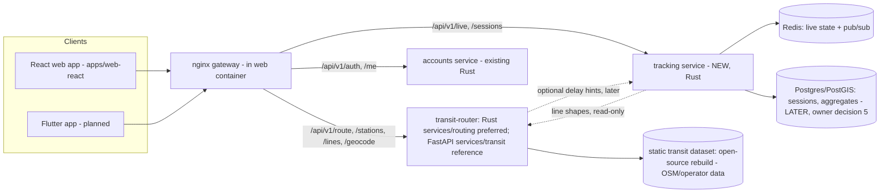

# bledi.tn: Agent Brief

Fixes, MapLibre basemap migration, and splitting the app into services.

This file is written for a coding agent (Claude Code or similar). Read sections 0 and 1 first, then work through section 8 in order.

---

## 0. Rules for the agent

1. **Inspect before changing.** Section 1 lists assumptions about the repo layout. Verify them (`git ls-files`, read the compose file, read the README) and adapt paths. If reality differs, note it in `docs/decisions/` and continue.
2. **Small, reviewable commits.** One task = one branch/commit series. Run tests before and after every task.
3. **Never overwrite source data.** `data/seed_all_tunisia_routes.json` stays untouched. All cleaning goes to derived files (`*.tagged.json`, `*.cleaned.json`) produced by scripts in `scripts/`.
4. **Never commit** binaries or archives (`*.zip`), `.env` files, secrets, `node_modules/`, `target/`, or `__pycache__/`.
5. **No silent API breaks.** The public API is versioned (`/api/v1`). If a response shape must change, add a field or add `/api/v2`; do not rename fields in place.
6. **Every new endpoint gets** an OpenAPI description, input validation, a timeout/error path, and at least one test.
7. **Ask the owner** (do not guess) before: choosing a data license, deleting any data file, or adding a paid third-party service.
8. Keep this file updated: tick tasks in section 8 as they land.

---

## 1. Current state and assumptions

**Reconciled 2026-11-26 (see `docs/decisions/0002-owner-decisions.md`).** The
original assumptions below described an older state; the right-hand column
records the verified reality. Paths in later sections that say `apps/web`
mean `apps/web-react`, and `services/transit-router` means `services/transit`
(the Rust calculation service is `services/routing`).

| Item | Assumed state (old) | Actual state (verified) |
|---|---|---|
| Public repo | `cy1ingachref/bledi.tn`: FastAPI backend (`src/backend/app/main.py`), single-file Leaflet UI (`frontend/index.html`) | `cy1ingachref/bledi.tn`: React+Vite frontend `apps/web-react` on :8080; FastAPI `services/transit`; Rust routing `services/routing`; Rust accounts `services/accounts`. `apps/web` (SvelteKit) is legacy. |
| Newer stack | Svelte 5 app in `apps/web-new`, Leaflet | Superseded: React app at `apps/web-react`, MapLibre GL 6 with Maptoolkit Dark style, nginx gateway container. |
| Router | Dijkstra, walk 4.5, bus 22, train/metro 80, half-headway wait, 3 min transfer, metered taxi | Preserved in `services/transit` (Python reference) and `services/routing` (Rust, preferred). Shared tunables in `data/shared_tunables.json`. |
| Data | 232 lines, 1,711 stations, Tunismapper-derived, license unresolved | ~7,452 stations / 379 lines in the current seed; Tunismapper-derived data is being retired in favour of an open-source rebuild (owner decision 1). |
| Basemap | Maptoolkit Dark just changed | MapLibre migration in flight on `apps/web-react` (worker, CSP, logo control all working in Docker). |
| Not present yet | Any live location / tracking service | Confirmed absent. |

## 1b. Phase status (2026-11-26)

- Phase 0 complete: `docs/decisions/0001-baseline.md`, tag `baseline-2026-11`.
- Owner decisions resolved in `docs/decisions/0002-owner-decisions.md`.
- React is canonical; Docker stack verified healthy; CI being repointed
  from `apps/web` to `apps/web-react`.
- Fixes PR 1 (H2/L1/L2): routing port unpublished, healthchecks aligned, transit db dependency removed.
- Open (owner has not chosen): pilot region, tracking privacy retention/minimum
  contributors.

---

## 2. Target architecture

Two backend services with a hard boundary, behind one gateway.



**Principles**

- **Router = pure calculation.** It owns the static network (stations, lines, shapes, fares) and answers "how do I get from A to B". It is stateless and read-only, so it scales horizontally and is easy to test.
- **Tracking = live state.** It owns users' location pings, vehicle position estimates and privacy rules. It never computes routes.
- **Live data is an overlay, not a dependency.** The router must work with the tracking service completely down. Later, the router can optionally read delay hints through a `DelayProvider` interface (default: no-op).
- **Separate datastores.** Each service owns its own storage. No cross-service SQL joins.
- **Contracts first.** OpenAPI specs live in `contracts/`. Clients (Svelte, later Flutter) are generated from them.

### Target repo layout (monorepo)

```
bledi.tn/
  services/
    transit-router/        # FastAPI (existing code moves here)
      app/ (api/, core/, data/, adapters/)
      tests/
    tracking/              # NEW (see section 4)
    accounts/              # existing, untouched except path
  apps/
    web/                   # SvelteKit / Svelte 5 + Vite + Tailwind 4
  contracts/
    transit-router.openapi.yaml
    tracking.openapi.yaml
    events/                # JSON Schemas for WS messages
  data/                    # seed files (original untouched) + tagged/cleaned
  scripts/
  infra/
    docker-compose.yml
    gateway/Caddyfile
  docs/ (decisions/, provenance.md, roadmap.md)
  archive/
```

---

## 3. Service A: `transit-router` (calculation and routing)

### Responsibilities

- Load the dataset at startup (read-only) and build the graph.
- Stations, lines, shapes, nearest-station lookups.
- Multi-modal routing: walk + transit + taxi estimate.
- Fares and durations.
- Adapters (isolated modules, easy to swap): OSRM (driving geometry) and Nominatim (geocoding) with TTL cache, rate limiting and timeouts.

### Not its job

Storing user locations, vehicle tracking, authentication.

### Endpoints (keep existing paths; add what is missing)

| Method | Path | Notes |
|---|---|---|
| GET | `/health`, `/ready` | `/ready` is true only once the graph is built |
| GET | `/api/v1/stations?bbox=&q=&mode=` | search/filter; paginated |
| GET | `/api/v1/stations/nearby?lat=&lon=&radius_m=` | spatial index, not a full scan |
| GET | `/api/v1/lines`, `/api/v1/lines/{id}` | include `shape` (GeoJSON LineString) for the tracking service |
| POST/GET | `/api/v1/route/transit` | keep the `best_fastest` shape; add `alternatives[]` and optional `depart_at` |
| GET | `/api/v1/route/plan` | combined plan (existing) |
| GET | `/api/v1/geocode?q=` | proxied Nominatim, rate-limited and cached |

### Internal structure

```
app/
  api/         # FastAPI routers, request/response models (pydantic)
  core/        # graph.py, router.py, fares.py, geo.py (spatial index), delays.py
  data/        # loader.py (reads tagged seed), validators.py
  adapters/    # osrm.py, nominatim.py
  main.py
```

`core/delays.py` defines the extension point:

```python
class DelayProvider(Protocol):
    def delay_seconds(self, line_id: str, station_id: str) -> int: ...

class NoDelays:
    def delay_seconds(self, line_id, station_id): return 0
```

The router depends only on this interface. Later, an HTTP implementation can call the tracking service; the default stays `NoDelays`.

---

## 4. Service B: `tracking` (location and live tracking), NEW

Status: **does not exist yet.** Build it in stages (section 8, phases 5 and 6). Rail first, then metro/tram, then buses.

### Responsibilities

- Accept anonymous location pings from riders who opted in.
- Match pings to a line (snap to the line shape provided by the router).
- Merge pings from several riders on the same vehicle into one **vehicle estimate**.
- Publish live vehicle positions (HTTP snapshot + WebSocket stream).
- Enforce trust and privacy rules.

### Not its job

Route calculation, station data ownership, user accounts. It only validates an auth token issued by `accounts`.

### Suggested stack (decide with the owner)

- **Rust + axum + tokio** (fits the existing Rust backend experiment), **Redis** (GEO + pub/sub or streams) for live state, **Postgres/PostGIS** for sessions and aggregates.
- Alternative for speed of development: FastAPI + Redis. Either way, the contract below stays the same.

### Data model

```
session   : id, anon_id (rotating), mode, line_id?, direction?, started_at, ended_at
ping      : session_id, ts, lat, lon, accuracy_m, speed_mps?, heading_deg?
vehicle   : vehicle_key (line_id + direction + cluster), lat, lon, bearing, speed_mps,
            confidence (0..1), contributors, updated_at
```

### API contract (v1)

| Method | Path | Purpose |
|---|---|---|
| POST | `/api/v1/sessions` | start sharing: `{mode, line_id?}` returns `{session_id, token}` |
| POST | `/api/v1/sessions/{id}/pings` | batch of pings (HTTP fallback) |
| WS | `/api/v1/sessions/{id}/stream` | ping stream |
| DELETE | `/api/v1/sessions/{id}` | stop sharing and delete raw pings |
| GET | `/api/v1/live/vehicles?bbox=&line_id=&mode=` | current snapshot |
| WS | `/api/v1/live/subscribe?bbox=&line_id=` | vehicle updates |
| GET | `/internal/v1/delays?line_id=` | for the router later; not exposed via the gateway |

Example vehicle message (this is also the JSON Schema to put in `contracts/events/`):

```json
{
  "type": "vehicle.update",
  "vehicle_key": "L12:out:3",
  "line_id": "L12",
  "mode": "train",
  "position": {"lat": 36.8065, "lon": 10.1815},
  "bearing_deg": 212,
  "speed_mps": 18.4,
  "confidence": 0.82,
  "contributors": 3,
  "updated_at": "2026-11-26T10:21:07Z"
}
```

### Processing pipeline

1. **Validate**: schema, `accuracy_m` under a threshold (start at 50 m), timestamp within a tolerance of server time.
2. **Plausibility**: reject teleports and speeds impossible for the mode (set per-mode caps in config).
3. **Map-match**: snap to the line shape. Rail first, because tracks are fixed and unambiguous.
4. **Cluster**: pings from different sessions that are close in position, speed and heading within a few seconds are treated as one vehicle.
5. **Smooth**: median/Kalman filter, then compute `confidence` from contributor count and agreement.
6. **Publish**: write to Redis, push to WS subscribers (bbox filter).
7. **Expire**: vehicles with no update for N seconds disappear.

### Privacy and safety (required, not optional)

- Explicit opt-in; the UI must show a clear "you are sharing your position" indicator and a one-tap stop.
- Anonymous, rotating IDs; do not link sessions to accounts in stored data.
- Keep raw pings only briefly (start with 24 h or less); keep aggregates. Delete raw pings when a session ends if feasible.
- Do not publish a vehicle estimate from a single contributor unless the owner decides otherwise (this prevents tracing one person).
- Rate-limit per device and per IP; cap WS connections.
- Confirm requirements under Tunisia's personal-data law (Organic Law 2004-63) and the INPDP regulator with a legal source before any public launch. This is not legal advice.

### Stage 0 (do first): simulator

Before any real crowdsourcing, build a **simulator** that replays a seeded rail line at realistic speed and publishes `vehicle.update` messages. This lets the frontend build and test the live layer (section 6.5) without real users.

### Mobile notes (Flutter later)

Background location with adaptive intervals (for example, 5 s while moving, 30 s when idle), batched uploads, and a visible battery-friendly mode.

---

## 5. Gateway and contracts

### Gateway (Caddy or Traefik)

```
/api/v1/auth/*, /api/v1/me      -> accounts
/api/v1/live/*, /api/v1/sessions/* -> tracking   (WebSocket upgrade enabled)
/api/v1/*                        -> transit-router
/                                -> web
/internal/*                      -> blocked (never public)
```

### Compose (sketch)

```yaml
services:
  gateway:  { image: caddy:2, ports: ["8080:80"], depends_on: [transit, tracking, accounts, web] }
  transit:  { build: ../services/transit-router, expose: ["8000"], healthcheck: {test: ["CMD","curl","-f","http://localhost:8000/health"]} }
  tracking: { build: ../services/tracking,       expose: ["8100"], depends_on: [redis, db] }
  accounts: { build: ../services/accounts,       expose: ["8200"], depends_on: [db] }
  redis:    { image: redis:7 }
  db:       { image: postgis/postgis:16-3.4 }
  web:      { build: ../apps/web-react }
```

Use separate databases or schemas per service. Add a healthcheck to every service (the transit `/health` healthcheck is still unverified).

### Contracts

- Write `contracts/*.openapi.yaml` first; generate TypeScript types for the Svelte app (for example with `openapi-typescript`).
- Add a CI check that fails if a service's live OpenAPI output drifts from the committed contract.

---

## 6. Basemap: Maptoolkit Dark with MapLibre

### 6.1 Fix the URL first

`https://makewithmaplibre.com/basemaps/styles/maptoolkit-dark/` is a **directory page** describing the style, not the style itself. If it is set as the map `style`, the map will not load (it returns HTML, not style JSON).

The style JSON linked from that page is:

```
https://styles.maptoolkit.org/dark.json
```

Put it in config, not in code: `VITE_MAP_STYLE_URL=https://styles.maptoolkit.org/dark.json`.

### 6.2 Terms: logo and credit are mandatory

The directory page says the style is free with no API key, but Maptoolkit's terms require its **logo and credit visible on the map**. Implement exactly this pattern:

```ts
import maplibregl from "maplibre-gl";
import { LogoControl } from "@maptoolkit/maplibre-logo-control";
import "@maptoolkit/maplibre-logo-control/style.css";

const map = new maplibregl.Map({
  container,
  style: import.meta.env.VITE_MAP_STYLE_URL,
  attributionControl: { compact: false },   // credit must stay fully visible
});
map.addControl(new LogoControl());
```

Do not hide, shrink or collapse the attribution on mobile. Also keep OpenStreetMap attribution wherever OSM-derived services (Nominatim, OSRM) are used.

### 6.3 The style does not work with Leaflet: migrate the map component

Leaflet cannot render a vector style JSON. Options:

- **Recommended: migrate to `maplibre-gl`** in a single `Map.svelte` component (a Svelte wrapper library may be evaluated, but a thin in-house wrapper is acceptable). This also unlocks what the roadmap needs: pitch, 3D extrusions, terrain, globe, and smooth live-vehicle animation for tracking and the 3D shop map.
- Stopgap only: a Leaflet-to-MapLibre bridge plugin. Do not build new features on it.

Also: pin the `maplibre-gl` version (exact version in `package.json`) and review upgrade notes before bumping.

### 6.4 Suggested module structure (apps/web-react)

```
src/lib/map/
  config.ts          # style URL, default center/zoom (Tunisia), bounds
  createMap.ts       # map init, LogoControl, RTL plugin, error handling
  theme.ts           # color tokens for dark base (route/mode colors)
  layers/
    stations.ts      # clustered GeoJSON source + layers
    route.ts         # route casing + line + dashed walk segments
    vehicles.ts      # live vehicles (section 6.5)
  ensureLayers.ts    # idempotent add/re-add of all custom layers
```

### 6.5 Replace Leaflet layer-groups with GeoJSON sources

- **Stations (1,711+):** one GeoJSON source with `cluster: true`. Never create DOM markers per station. Show labels from a zoom threshold.
- **Route:** GeoJSON source, a `line` layer with a light casing underneath so colors stay readable on the dark base. Walk segments use `line-dasharray`. "Clear route" means `source.setData(emptyFeatureCollection)`, replacing the old `transitLayer.clearLayers()`.
- **Live vehicles (for the tracking service):** GeoJSON source updated from the WebSocket (`setData`, throttled to about 1 update/second); a symbol or circle layer with bearing rotation and a short animation between positions.
- **Layer order:** insert custom layers **below the first label (`symbol`) layer** so place names stay above routes (find it from `map.getStyle().layers`, then pass `beforeId`).

### 6.6 Style lifecycle bugs to avoid

- Add sources/layers only after the map `load` event.
- If the theme is switched with `map.setStyle(...)`, all custom layers are wiped. Call `ensureLayers()` on every `style.load` event. It must be idempotent (check `map.getSource(id)` / `map.getLayer(id)` first).
- Offer a light style as an alternative (pick one from the same makewithmaplibre.com basemap directory and check its terms), and follow `prefers-color-scheme` by default.

### 6.7 Arabic and French labels

- **Arabic shaping:** MapLibre needs the RTL text plugin to render Arabic labels correctly. Call `maplibregl.setRTLTextPlugin(...)` once, before the map is created, and **self-host the plugin file** (avoids CSP/CDN problems).
- **Language switch:** inspect the style's symbol layers and the tile schema to find the real name properties (`name:ar`, `name:fr`, `name_ar`, etc.; do not assume). Then update each layer's `text-field` with a `coalesce` expression falling back to `name`.
- Test with Tunis, Sfax, Sousse and Djerba labels in both languages.

### 6.8 Network and CSP

- Fetch `dark.json` and list every host it references (tiles, glyphs, sprites, terrain/hillshade source). Allow them in the Content-Security-Policy: `connect-src`, `img-src`, `font-src` as needed, plus `worker-src blob:` for MapLibre's worker.
- If the gateway or Vite proxy sits in front, do **not** proxy tiles through the backend; let the client fetch them directly.

### 6.9 Reliability: this is a free third-party service

A free, no-key style has no SLA and could change terms or go down. Mitigate:

- Handle `map.on("error")`: if the style fails to load, switch to a minimal fallback style (background + water + land + roads from a second source) and show a small notice.
- Keep the style URL in config so it can be swapped without a release.
- Long term, consider self-hosting a Tunisia tile extract (PMTiles) with your own style. This also enables offline use for the Flutter app.
- Re-check the provider's current terms before any commercial launch.

### 6.10 Performance (mobile first)

Cap `pixelRatio` on low-end devices, cluster stations, throttle live updates, avoid re-creating the map on route changes, and measure first-map-render time on a mid-range phone.

### 6.11 Contrast and accessibility

Pick transit line colors that pass contrast checks against the dark base (use the casing from 6.5); do not rely on color alone (add line labels/icons per mode).

### 6.12 3D readiness

The style advertises hillshading. Check whether it includes building footprints/heights; if not, add a buildings source before building 3D features. The planned 3D map view for tracking and any 3D shop models should build on `maplibre-gl` (pitch, `fill-extrusion`, terrain).

### 6.13 Tests

Playwright smoke test: style returns HTTP 200 and JSON; map renders; Maptoolkit logo and attribution are visible; a route draws; "clear route" removes it; switching theme re-adds all custom layers.

---

## 7. Review findings: fixes carried into the backlog

| # | Finding | Priority |
|---|---|---|
| F1 | Data derived from Tunismapper with unverified redistribution terms, already public; no code license | Critical |
| F2 | Router: ensure transfer penalty uses `(station, line)` state; ensure walking edges between nearby distinct stations; wait time only on boarding/line change; confirm louage/minibus modeling | High |
| F3 | README claims `frontend/index.html` works from disk but relative `/api/v1/*` fails on `file://` | Medium |
| F4 | Repo hygiene: `bledi.tn-review.zip` committed, duplicate frontends, session-style changelog in README, no description/topics/screenshot | Medium |
| F5 | Pilot region unresolved (all Tunisia vs Tunis to Bizerte) | Medium |
| F6 | API hardening: rate limits on Nominatim/OSRM proxies (Nominatim public policy is about 1 req/s), coordinate validation, timeouts, `/health`, spatial index | High |
| F7 | Data quality: 130 stations with unknown source, AR/FR name variants, near-duplicates, quarantined null-coordinate rows | High |
| F8 | No CI | Medium |
| F9 | No Arabic RTL / French UI support | Medium |

---

## 8. Phased task list

Tick boxes as tasks land. Each task lists acceptance criteria.

### Phase 0: baseline

- [x] **T0.1** Run the full test suite and the compose stack; record results in `docs/decisions/0001-baseline.md`.
  *Accepts:* tests green or failures documented; `transit /health` healthcheck verified.
- [x] **T0.2** Tag the current state (`git tag baseline-2026-11`).

### Phase 1: legal and repo hygiene (F1, F3, F4, F5, F8)

- [x] **T1.1** Remove `bledi.tn-review.zip` from the repo (add `*.zip` to `.gitignore`; publish handoffs as GitHub Releases). *Owner decision 2: remove zip. No `*.zip` is currently tracked; `*.zip` added to `.gitignore`.*
- [ ] **T1.2** Move `frontend/bledi-map.html` to `archive/`; update `docs/frontend-notes.md`.
- [ ] **T1.3** Replace the "in this session" TODO text in the README with `CHANGELOG.md` and GitHub issues. Add repo description, topics, and a screenshot.
- [ ] **T1.4** Fix or remove the "open from disk" claim in the README (set an absolute `API_BASE` config, or delete the claim).
- [x] **T1.5** **Ask the owner** about data licensing. *Owner decision 1: rebuild from open sources (OSM public-transport relations / operator data). See `docs/decisions/0002-owner-decisions.md`.*
- [ ] **T1.6** Add a code license once the owner chooses one (keep the dataset license separate).
- [ ] **T1.7** Decide the pilot region (owner) and align README, roadmap and tests. *STILL OPEN — owner has not chosen.*
- [ ] **T1.8** Add GitHub Actions: pytest, ruff, gitleaks, Semgrep on every PR.
  *Accepts:* CI green on a clean checkout.

### Phase 2: router correctness and data quality (F2, F6, F7)

- [ ] **T2.1** Audit `routing.py`: does the graph carry line identity? If not, refactor to `(station, line)` states so the transfer penalty applies only on line change. Add tests: same-line ride has no penalty; changing line adds exactly the penalty; first boarding adds half headway.
- [ ] **T2.2** Add walking edges between distinct stations within a configurable radius (start at 300 to 400 m) using a spatial index (grid or KD-tree). Test with a known multi-station hub.
- [ ] **T2.3** Verify and document how louage/minibus services are modeled; if absent, write an issue (do not invent data).
- [ ] **T2.4** API hardening: coordinate bounds validation, timeouts on adapters, rate limiter for Nominatim/OSRM routes, `/health` and `/ready`.
- [ ] **T2.5** Data tests: every line's stops resolve; every line is connected; coordinates inside Tunisia's bounds; no station without coordinates in the cleaned output.
- [ ] **T2.6** Data script: normalize AR/FR names, flag near-duplicate stations for human review (do not auto-merge); report the 130 unknown-source stations.

### Phase 3: basemap migration (section 6)

- [ ] **T3.1** Set `VITE_MAP_STYLE_URL=https://styles.maptoolkit.org/dark.json`; remove the directory-page URL everywhere.
- [ ] **T3.2** Create `src/lib/map/*` per 6.4 with `maplibre-gl` (exact pinned version), `LogoControl`, non-compact attribution.
- [ ] **T3.3** Port stations, route and "clear route" to GeoJSON sources/layers per 6.5; remove Leaflet from the new app.
- [ ] **T3.4** Implement `ensureLayers()` bound to `style.load`; add light/dark switch.
- [ ] **T3.5** Self-host the RTL text plugin; implement the AR/FR label switch (6.7).
- [ ] **T3.6** CSP: allow the hosts found in `dark.json` (6.8).
- [ ] **T3.7** Add the style-failure fallback (6.9).
- [ ] **T3.8** Playwright smoke tests (6.13).
  *Accepts:* map loads on desktop and a mobile viewport; logo and credit visible; no console errors; route draw/clear works.

### Phase 4: split the services (section 2, 3, 5)

- [ ] **T4.1** Create `contracts/transit-router.openapi.yaml` from the current API; add a CI drift check.
- [ ] **T4.2** Move the backend to `services/transit-router/` (actual repo: keep `services/transit` as FastAPI reference and `services/routing` as Rust calculation service — owner decision 4: Rust-first) with the internal structure in section 3; add `core/delays.py` with `NoDelays`.
- [ ] **T4.3** Expose line shapes: `GET /api/v1/lines/{id}` returns a GeoJSON `shape` (the tracking service needs it).
- [ ] **T4.4** Add the gateway (`infra/gateway`) and move the compose file to `infra/`; route per section 5; block `/internal/*`.
- [ ] **T4.5** Generate the TypeScript client from the contract and use it in `apps/web-react` (the React frontend — owner decision 3).
  *Accepts:* `docker compose up` brings the whole stack up; the web app routes a trip through the gateway; the router works with no other service running.

### Phase 5: tracking service MVP (section 4), NEW

- [ ] **T5.1** Write `contracts/tracking.openapi.yaml` and `contracts/events/vehicle.update.schema.json` (section 4).
- [ ] **T5.2** Scaffold `services/tracking/` with `/health`, Redis and Postgres connections, and config for plausibility caps.
- [ ] **T5.3** Build the **simulator**: replays a seeded rail line at realistic speed and publishes `vehicle.update` over WS and `/api/v1/live/vehicles`.
- [ ] **T5.4** Frontend: `layers/vehicles.ts` driven by the WS stream; reconnect with backoff; throttle updates.
- [ ] **T5.5** Sessions and pings endpoints with validation, rate limits and token auth from `accounts`.
- [ ] **T5.6** Map-matching to the line shape (rail first) plus clustering and smoothing per the pipeline.
- [ ] **T5.7** Privacy controls: opt-in UI indicator, one-tap stop, raw-ping retention job, minimum contributors before publishing.
  *Accepts:* with simulator on, vehicles move on the map; with the tracking service stopped, routing still works; no raw pings older than the retention window remain.

### Phase 6: hardening and product

- [ ] **T6.1** Load test both services (routing latency target and WS fan-out).
- [ ] **T6.2** Arabic RTL and French UI pass across the whole app.
- [ ] **T6.3** Observability: structured logs, request IDs, basic metrics per service.
- [ ] **T6.4** Plan the Flutter client against the generated contracts; reuse the same style URL and WS protocol.
- [ ] **T6.5** Legal/privacy review before any public tracking launch (section 4).

---

## 9. Definition of done (every task)

- Tests added or updated, and the full suite passes locally and in CI.
- No secrets, large binaries or generated files committed.
- OpenAPI contracts updated if an endpoint changed.
- README/CHANGELOG updated if behaviour changed.
- This file's checkboxes updated.
