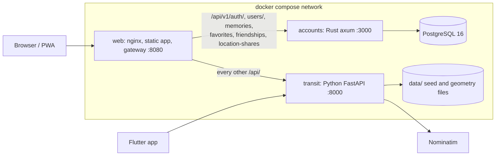
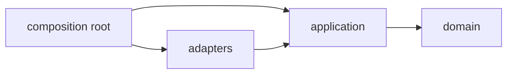

# Architecture

## System

- The web image's nginx is the single entry point. It routes by path prefix,
  read from `ACCOUNTS_URL` and `TRANSIT_URL`. The Vite dev and preview servers
  use the same map.
- Only the gateway is published. The gateway overwrites `X-Forwarded-For`, so
  both accounts and transit can trust it for per-IP rate limits
  (`TRUST_PROXY_HEADERS=1` set on both services in `docker-compose.yml`). Transit
  logs the effective value at startup as `rate limit: trust_proxy=...`.
- Accounts connects as its own non-superuser role on plain PostgreSQL. It needs
  no extension: nearby queries filter on a `(lat, lon)` bounding box index,
  then compute the haversine distance in SQL.
- Transit holds no database. It loads the seed network and geometry from
  `data/` at startup.

Who owns what:

- Transit: stations, lines, map layers, routing, place search.
- Accounts: users, tokens, memories, favorites, friendships, location shares.
- Web: no business logic beyond shaping transit results for the map.

## Layers

Every service uses the same four layers. Dependencies point inward only.

- Domain: pure types and rules. No I/O, no framework.
- Application: use cases, and the ports (interfaces) they need from the outside.
- Adapters: one per technology, named after it (`postgres`, `http`, `nominatim`).
  They implement ports or drive use cases.
- Composition root: reads the configuration once and wires adapters into use
  cases. It is the only place that knows every concrete type.

Each port has an in-memory fake, so use cases are tested without a database or
a network.

### Accounts (`services/accounts`)

- `bledi-domain`: users, memories, friendships, favorites, location shares, geo
  math, text validation.
- `bledi-application`: one service per area and the ports `UserStore`,
  `MemoryStore`, `FriendshipStore`, `FavoriteStore`, `LocationShareStore`,
  `PasswordHasher`, `TokenIssuer`, `Clock`. The `testing` feature holds the fakes.
- `bledi-postgres`: the stores, with embedded migrations.
- `bledi-http`: axum routes, extractors, CORS, rate limits, error mapping.
- `bledi-server`: the binary. Config, bcrypt, JWT, wiring.

Crate dependencies enforce the direction: the domain and application crates
cannot import axum or sqlx because they do not depend on them.

Errors carry a closed set of snake_case codes. A 5xx body is always
`{"error": "internal"}`, with the cause only in the log.

### Transit (`services/transit/src/bledi_transit`)

- `domain`: modes, fares, cities, geo, stations, timetable, cost tunables.
- `application`: the catalog and routing use cases, the router and planner, and
  the ports `MapLayers`, `PathGeometry`, `Geocoder`.
- `adapters`: seed files, road and rail graphs, Nominatim, FastAPI routes.
- `main.py`: `Config.from_env()` and `create_app()`.

`lint-imports` enforces the direction and keeps fastapi, starlette, pydantic,
uvicorn and numpy out of the domain and application.

### Web (`apps/web/src/lib`)

- `domain`: transit types, modes, itinerary rules.
- `application`: the `TransitService` port, trip planning, map data shaping.
- `adapters/http`: `TransitService` over `fetch`. `adapters/memory`: the fake.
- `ui`: Svelte components. They get the service from context, never an adapter.
- `app/services.ts`: the composition root.

ESLint `no-restricted-imports` rules enforce the direction and keep Svelte and
Leaflet out of the domain and application.

## Conventions

- Configuration is read once, in the composition root. A missing secret or an
  invalid value stops startup with a message that says how to fix it.
- No default credentials anywhere. Compose fails without a `.env`.
- Images run as a non-root user.
- Each service has its own CI workflow, triggered by its paths. The `e2e` label
  boots the whole compose stack and checks it through the gateway.
